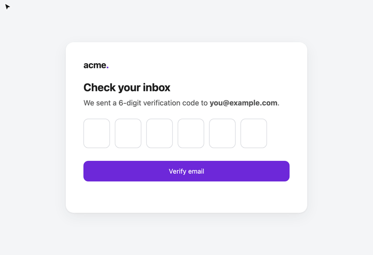

# Email Code Autofill

**Your browser fills in SMS codes for you. This does the same for codes sent by email.**

Click into a verification code field and the code you just received in Gmail shows up right below it, with a soft chime. One click (or Tab) and it's filled. No more switching to your inbox, finding the email and copying six digits.



## Why another one?

Other extensions that do this ask you to sign in with Google, create an IMAP app password, or run a companion app or server. This one needs **none of that**:

- **Zero setup.** It uses the Gmail session already open in your browser. Install it, done.
- **Nothing leaves your browser.** No server, no AI, no third party. About 200 lines of plain JavaScript you can read in five minutes.
- **Quiet.** It only checks your inbox while a code field is focused (every 3 seconds, for 3 minutes max), not all day long.
- **Works in any Chromium browser**: Chrome, Dia, Arc, Brave, Edge. Nothing tied to Chrome's Google account sign-in.
- **Split code boxes** (one digit per box) are filled too.
- **Never suggests a stale code**: only emails from the last 15 minutes count.

## How it works

```
You focus a code field on any site
        │
        ▼
content.js detects it (autocomplete="one-time-code", "code", "OTP", "verification"…)
        │
        ▼
background.js reads your Gmail Atom feed (mail.google.com/mail/u/0/feed/atom)
with your existing session: subject + preview of your unread emails
        │
        ▼
Finds a code next to a word like "code" in an email from the last 15 minutes
        │
        ▼
Chip below the field: "Code from Gmail 482913 · Acme"  →  click or Tab to fill
```

The Atom feed only lists **unread** emails. If you open the email in Gmail first, `gmail.js` reads the code from the opened message (only if Gmail says it arrived minutes ago) and keeps it for 15 minutes, so it is still suggested.

## Install

1. `git clone https://github.com/benjaminb10/email-code-autofill.git`
2. Open `chrome://extensions` (or your browser's equivalent) and turn on **Developer mode**.
3. Click **Load unpacked** and pick the `email-code-autofill` folder.
4. Reload your Gmail tab once, and make sure you're signed in to Gmail in that browser.

Try it on [the demo page](docs/demo.html) or on any sign-up that emails you a code.

## Permissions

| Permission | Why |
|------------|-----|
| `mail.google.com` | Read your unread emails' subject and preview (Atom feed), and the code of an email you open in Gmail |
| Content script on all sites | Detect code fields and show the suggestion |
| `storage` | Keep the code of an opened email for 15 minutes (session only, cleared when the browser closes) |

Codes never leave your machine.

## Limits

- Gmail only, and only the first account signed in to the browser (`/mail/u/0`).
- An email read on another device (your phone) before you focus the field is not seen.
- It relies on Gmail's Atom feed, which is old and undocumented. If Google ever turns it off, the unread part stops working.

## License

MIT
